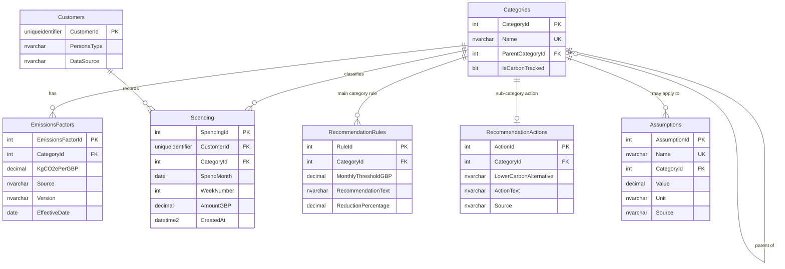
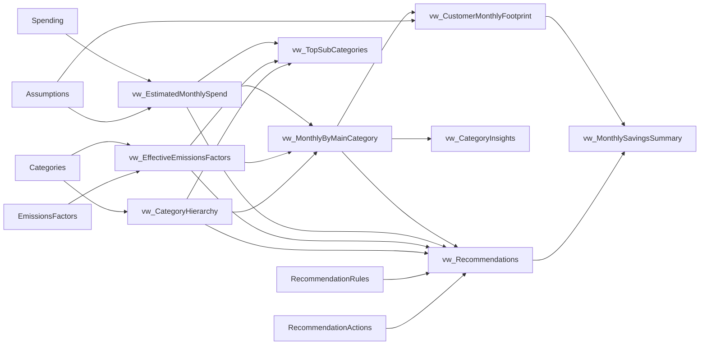

# Data Documentation

Owner: Data Engineer (Yihong Wang)

## 1. Data sources

| Data | Source | Notes |
|---|---|---|
| Customer spending (test data) | QA starter repo [`qatrainer/Nationwide-TDP-2026-v2/test-data`](https://github.com/qatrainer/Nationwide-TDP-2026-v2), copied to `src/test-data` | **v1** (`sample_customer_spending.csv`, customers 1-3 x 3 weeks) is loaded for testing by `test_spending.sql`. **v2** and **v3** (adds customer 4, Heathrow commuter) are kept out of the database to test the upload endpoints |
| Spending thresholds | Appendix A - Recommended UK Spending Personas (project brief in [`Capstone-PDFs`](../Capstone-PDFs)) | Monthly: Travel £300, Food £250, Utilities £150 |
| Shopping threshold | [ONS *Family spending in the UK, April 2024 to March 2025*](https://www.ons.gov.uk/peoplepopulationandcommunity/personalandhouseholdfinances/expenditure/bulletins/familyspendingintheuk/april2024tomarch2025) | Monthly: Shopping £250 (see section 3) |
| Recommendation logic and examples | Appendix B - Recommendation Engine Examples (project brief in [`Capstone-PDFs`](../Capstone-PDFs)) | Rule-based; savings and carbon formulas |
| Emission factors | [**UK Government (Defra / University of Leeds), "UK and England's carbon footprint to 2023" - Spend-based emissions multipliers**](https://www.gov.uk/government/statistics/uks-carbon-footprint), sheet `COICOP_multipliers_2023` (published 30 June 2026, Open Government Licence 3.0) | kgCO2e per £, **including VAT**. COICOP is the household-spending classification, so it fits customer spending |
| Sample spending (Sprint 3) | Synthetic, generated with AI assistance (Claude) and checked by the data engineer: `sample_spending.sql` | 8 customers with different spending patterns, Sep-Nov 2026, saved against sub-categories. Expected results in [`sample_expected_results.md`](sample_expected_results.md) |
| UK average footprint | [UK Gov, *Carbon footprint for the UK and England to 2023*](https://www.gov.uk/government/statistics/uks-carbon-footprint/carbon-footprint-for-the-uk-and-england-to-2023) | 631 kg per person per month (section 3) |

No real customer data is used. All data is synthetic or test data.

**AI use.** The Sprint 3 sample spending, the expected results and parts of the SQL were drafted with AI assistance (Claude). They were reviewed before use: the data-quality checks in `queries.sql` (sections 4, 6, 7, 8 and 9) all return no rows on Azure, and the view results match `sample_expected_results.md`.

## 2. Tables and views (`infra/database/schema.sql`)

| Table / view | Purpose |
|---|---|
| `Categories` | Spending categories in two levels: main categories (`ParentCategoryId` empty) and sub-categories (`ParentCategoryId` = their main category). `IsCarbonTracked` = 0 for spend that is recorded but has no carbon (mortgage) |
| `EmissionsFactors` | kgCO2e per £ for each category, with **Source, Version, EffectiveDate** |
| `Assumptions` | Documented calculation rules (thresholds, weeks per month, reduction %) |
| `Customers` | One row per customer. `CustomerId` is the Microsoft Entra user ID (a UUID), filled in by the API at sign-in. The 4 test customers use fixed IDs `00000000-0000-0000-0000-000000000001` to `...004` |
| `Spending` | One row per customer, category, month and week. `CategoryId` can be a main category or a sub-category. `SpendMonth` = month the user selects; `WeekNumber` = week 1-5 for CSV uploads, empty (NULL) for a manual whole-month total |
| `RecommendationRules` | Monthly threshold, recommendation text and reduction % per **main** category |
| `RecommendationActions` | A lower-carbon alternative and a practical action per **sub**-category, with its source (Sprint 3) |
| `vw_CategoryHierarchy` (view) | Each category with its main category |
| `vw_EffectiveEmissionsFactors` (view) | The factor each category uses: its own latest factor, otherwise its main category's; empty if not carbon-tracked |
| `vw_EstimatedMonthlySpend` (view) | Monthly spend per customer, category and month: the manual total if entered, otherwise weekly average x 4.33 |
| `vw_MonthlyByMainCategory` (view) | Monthly spend and carbon per customer and main category, with sub-categories added up. Used for thresholds, recommendations and the dashboard |
| `vw_CustomerMonthlyFootprint` (view) | Total spend and carbon per customer and month, kg CO2e per £, change from the previous month, and comparison with the UK average |
| `vw_CategoryInsights` (view) | Each main category's spend and carbon, its share of the month (%), its rank by carbon, and change from the previous month |
| `vw_Recommendations` (view) | One row per main category over its threshold: advice, the sub-category to focus on, its alternative and action, £ saved, kg CO2e saved and priority |
| `CustomerChallenges` (table) | Each customer's challenges: category, month, status (NOT_STARTED / IN_PROGRESS / COMPLETED), started and completed dates. A challenge is a recommendation the customer has chosen to act on |
| `vw_CustomerChallenges` (view) | Every recommendation with its challenge status, for the API to list challenges |
| `vw_CustomerMedals` (view) | Completed challenges per customer and medal: 1+ Bronze, 3+ Silver, 5+ Gold |
| `vw_MonthlySavingsSummary` (view) | One row per customer and month: number of recommendations, total £ saved, total kg CO2e saved, footprint after the savings and % of footprint saved |
| `vw_TopSubCategories` (view) | Carbon per sub-category, ranked within the month, to show what drives the footprint (e.g. Gas rather than Utilities) |

### What's in the database (after `seed.sql` and `test_spending.sql`)

| Table | Rows | Content |
|---|---|---|
| `Categories` | 19 | 6 main categories + 13 sub-categories |
| `EmissionsFactors` | 18 | One factor per category, except Mortgage (not carbon-tracked) |
| `RecommendationRules` | 4 | Travel, Food, Utilities, Shopping |
| `RecommendationActions` | 11 | One per sub-category under Travel, Food, Utilities and Shopping |
| `Assumptions` | 12 | Calculation rules (weeks per month, thresholds, reduction %, UK average) |
| `Customers` | 4 | Test customers 1-4 (fixed UUIDs ending in 1-4) |
| `Spending` | 27 | Test data v1: 3 customers x 3 weeks x 3 main categories (0 if only `seed.sql` is run) |

After `sample_spending.sql` as well: `Customers` 12 and `Spending` 503 (27 + 476).

| Main category | Sub-categories | kgCO2e per £ (main) | Monthly threshold | Reduction % | Advice when over threshold |
|---|---|---|---|---|---|
| 1 Travel | Fuel, Public transport, Flights | 2.7747 | £300 | 14% | Reduce solo car journeys, car share or switch some commutes to public transport |
| 2 Food | Groceries, Eating out | 0.6797 | £250 | 14% | Reduce takeaway meals, meal prep and batch cook |
| 3 Utilities | Electricity, Gas, Water | 2.0545 | £150 | 19% | Reduce heating by 1C, switch off unused devices and optimise appliance use |
| 4 Shopping | Clothing, Electronics, Furniture and appliances | 1.0227 | £250 | 16% | Buy second-hand, repair before replacing and keep phones and electronics for longer |
| 5 Housing | Rent, Mortgage (not carbon-tracked) | 0.0688 | none | none | none |
| 6 Other | none | 0.3598 | none | none | none |

The test CSVs only have Travel, Food and Utilities, so all 27 test rows are on those main categories. Sub-categories, Shopping, Housing and Other have factors and rules ready but no test spending yet; they fill up when users upload or enter spending. Sub-category factors are in section 3.

### Database design

**Entity relationship diagram**



**How the views build on each other**



**Design decisions**

| Decision | Why |
|---|---|
| Spending is stored as entered; every figure is calculated in views | One source of truth. The API and front end read the views, so the same customer gets the same numbers everywhere, and changing a factor or rule changes every result without touching stored data |
| Factors, thresholds, reduction % and actions are rows, not code | They can be updated in `seed.sql` (or by an admin endpoint) without a code change or redeploy. Each row has its source |
| Two-level categories (main and sub) in one table | Matches bank categorisation (Level 1 and Level 2). Thresholds work on main categories, carbon on sub-categories |
| Factors are versioned (`Version`, `EffectiveDate`) | The government updates the multipliers. A new version can be added without losing the old one, and the view uses the latest |
| `CustomerId` is the Microsoft Entra user ID (UUID) | Links each customer to their SSO login, with no separate user table or password |
| Validation in the database as well as the API | `CHECK`, `UNIQUE` and foreign-key constraints reject invalid data even if the API misses it (section 4) |
| Month stored as the 1st, week as 1-5 or empty | Supports both weekly CSV uploads and a manual monthly total (section 3) |

**Security and access**

- Connection details are only in the local `.env` file and GitHub Secrets, never in the repo.
- The Azure SQL firewall only allows the API and the team's IP addresses.
- The API uses parameterised queries, so customer input is never run as SQL.
- Only synthetic and test data is stored; there is no real customer data and no personal details beyond the Entra user ID.

## 3. How the data is used

**Spending data** = how much a customer spends in each category per week or month.

**Emission factor** = how many kg of CO2e are produced for each £1 spent in a category.

Core formulas (Appendix B):

```
CarbonImpact     = SpendAmount x EmissionFactor
ProjectedSavings = SpendAmount x ReductionPercentage
Recommendation   = IF MonthlySpend > Threshold THEN show advice
```

Example: customer 4 travel, estimated £3,140/month x 2.7747 = about 8,713 kgCO2e.

### Categories and sub-categories (added 16 Nov)

The test data only has three categories, but real uploads will have many more. Categories therefore have two levels: a **main category** (e.g. Travel) and optional **sub-categories** (e.g. Fuel). Spending can be saved against either: if the sub-category is unknown, it is saved against the main category.

This matches how bank categorisation works (e.g. Moneyhub, Nationwide's categorisation partner, uses Level 1 groups and Level 2 categories), and the main categories follow the areas used by bank carbon trackers (NatWest/Cogo: transport, groceries, bills, shopping). New categories are added as rows in `seed.sql`; no table or API change is needed. In production, the bank's own categories (e.g. Moneyhub Level 2) would be mapped to these categories.

Rules:
- Only two levels: a sub-category cannot have its own sub-categories.
- Thresholds and recommendations use **main categories**. Sub-category spend is added up to its main category (`vw_MonthlyByMainCategory`).
- Carbon is worked out per sub-category with its own factor, then added up. A sub-category without a factor would use its main category's factor (`vw_EffectiveEmissionsFactors`); currently every tracked category has its own.
- **Mortgage is not counted for carbon** (`IsCarbonTracked = 0`): it is a loan repayment, like a transfer, not a purchase. Bank carbon trackers exclude transfers for the same reason. Rent is counted, because it pays for a housing service (COICOP 4.1.1).
- **Other is counted** with the COICOP "Other services n.e.c." factor, so unclassified spending is not treated as zero carbon.
- Main category IDs 1-3 (Travel, Food, Utilities) are unchanged, so `test_spending.sql` and the test CSVs still work.

### Emission factors and category mapping

Each category is mapped to official COICOP rows (greenhouse gases, kgCO2e per £, incl. VAT). "avg" = simple, unweighted average of the listed rows.

| Main category | Factor (COICOP) | Sub-categories (factor, COICOP) |
|---|---|---|
| Travel | 2.7747 (7.2.2) | Fuel 2.7747 (7.2.2); Public transport 1.9424 (7.3.1_2); Flights 0.4773 (7.3.3) |
| Food | 0.6797 (11.1.1) | Groceries 0.5090 (avg 1.1.1-1.1.9); Eating out 0.6797 (11.1.1) |
| Utilities | 2.0545 (avg 4.5.1, 4.5.2) | Electricity 1.0317 (4.5.1); Gas 3.0773 (4.5.2); Water 0.1975 (4.4.1) |
| Shopping | 1.0227 (avg of its sub-categories) | Clothing 0.3535 (3.1.2); Electronics 1.6950 (avg 8.2.1, 9.1.1, 9.1.3); Furniture and appliances 1.0197 (avg 5.1.1, 5.3.1) |
| Housing | 0.0688 (4.1.1) | Rent 0.0688 (4.1.1); Mortgage: not counted |
| Other | 0.3598 (12.7.1 Other services n.e.c.) | none |

Why the main category factors: they are used when the user only gives the main category. Travel uses fuel because travel recommendations focus on car journeys; Food uses restaurants because food recommendations focus on takeaways and eating out; Utilities uses electricity and gas because utilities recommendations focus on heating and electricity use.

Limitations:
- Spend-based multipliers are national averages, so results are estimates.
- "avg" factors are unweighted; the sheet has no spending weights. A weighted average would need ONS household spending data.
- Spend-based factors are per £, not per km. Flights have a low factor per £ (0.4773) because tickets are expensive relative to fuel, so a flight can look lower-carbon than the same spend on petrol. Activity-based data (distance) would be more accurate for flights.
- The government notes it is reviewing how the multipliers are published from 2027.

### Thresholds and savings percentages

`ProjectedSavings = SpendAmount x ReductionPercentage`. The brief gives the formula but not the percentage, so each category's % is the average of its two Appendix B examples: Travel 14%, Food 14%, Utilities 19%. Stored in `Assumptions` and `RecommendationRules`, so they can be changed.

| Main category | Monthly threshold | Reduction % | Source |
|---|---|---|---|
| Travel | £300 | 14% | Appendix A / B |
| Food | £250 | 14% | Appendix A / B |
| Utilities | £150 | 19% | Appendix A / B |
| Shopping | £250 | 16% | ONS + Appendix B (below) |
| Housing, Other | none | none | No useful generic advice |

**Shopping threshold:** set near the UK average from ONS *Family spending in the UK, FYE 2025*: household goods and services about £40.60/week plus clothing and footwear about £17-22/week, x 4.33 ≈ £250-270/month, rounded down to £250. Its reduction % (16%) is the average of the other three, as Appendix B has no shopping example. ONS figures are per household, as are the Appendix A thresholds.

### Weekly vs monthly (team decision, 13 Nov)

- The test data is **weekly** (week 1-3, no dates), but the thresholds and the brief ("submit monthly spending") are **monthly**.
- In the app the user first **selects a month** (defaults to the current month, can be changed), then either:
  - **enters a monthly total manually** -> one row per category, `WeekNumber` empty (NULL), or
  - **uploads a CSV of weekly spending** -> one row per week and category, `WeekNumber` 1-5.
- Both are saved against the selected month (`SpendMonth`, stored as the 1st of the month), so no start date has to be assumed.
- The view works out the monthly figure:

```
MonthlySpend = manual monthly total, if the user entered one
             = average weekly spend x 4.33 otherwise   (52 weeks / 12 months)
```

- Adding up 3 weeks would undercount a month (e.g. £295 instead of about £426), so the weekly average x 4.33 is used instead.
- 4.33 is stored in the `Assumptions` table as `WeeksPerMonth`, so the rule is documented and can be changed.
- The month is required: spending without a month cannot be compared to the monthly thresholds or shown on the progress page.

### Carbon insights (Sprint 3)

The insight views follow what UK banks already show customers. NatWest's Carbon Footprint Tracker (with Cogo) shows a monthly footprint, the impact of each transaction, a comparison with the UK monthly average and tips. Starling's Spending Insights shows spending by category and merchant each month and each category's share.

| Insight | View | Example from the sample data |
|---|---|---|
| Monthly footprint | `vw_CustomerMonthlyFootprint` | Family (C102): 2,408 kg in November |
| Share by category (%) | `vw_CategoryInsights` | Student (C104), October: the laptop is half of the month's carbon |
| Biggest categories | `vw_CategoryInsights` (`CarbonRank`), `vw_TopSubCategories` | Retired homeowner (C105): Utilities is first every month, and Gas overtakes Fuel as the top sub-category from October |
| Change from last month | both views (`ChangeKg`, `ChangePct`) | Green switcher (C107): total down 22% in October and 28% in November |
| Carbon per £ | `vw_CustomerMonthlyFootprint` (`KgCO2ePerGBP`) | Retired homeowner 1.3 kg per £ vs student 0.4-0.7: heating is high-carbon spend |
| vs UK average | `vw_CustomerMonthlyFootprint` (`VsUkAvgPct`) | Student (C104) is 31% below the average in September |

**UK average.** In 2023 the UK footprint was 699 MtCO2e, about 10 tonnes per person. The household part is 407 MtCO2e (goods and services) + 122 MtCO2e (heating and driving) = 529 MtCO2e. 529 / 699 x 10,000 kg / 12 = about **631 kg per person per month**, stored in `Assumptions` as `UkAvgMonthlyKgPerPerson`.

**Limitations**
- The UK average is per person; some sample customers are households (e.g. the family), so they look higher than they would per person.
- The app only counts the categories it tracks, so the comparison is rough, as in the banks' own trackers.
- "Previous month" means the customer's previous month with data, so a missing month is skipped, not treated as zero.

### Recommendations (Sprint 3)

Recommendations are rule-based, so every one can be explained:

1. **When:** a main category's monthly spend is over its threshold (`RecommendationRules`, from Appendix A and ONS).
2. **What to change:** the sub-category with the most carbon in that main category, e.g. Fuel inside Travel or Gas inside Utilities.
3. **Lower-carbon alternative and action:** from `RecommendationActions`, one per sub-category, each with its source (Appendix B, WRAP, Energy Saving Trust or team decision).
4. **Saving:** monthly spend × reduction %, and the same for carbon (Appendix B). Money and carbon savings are shown side by side.
5. **Priority:** recommendations are ranked by carbon saved, so the customer sees the biggest win first.

Example (car commuter, September): Travel £411.66 is £111.66 over the £300 threshold. Most of it is Fuel, so the advice is to car share or take the bus or train. Saving: £57.63 and 159.91 kg CO2e a month. It is priority 1 because it saves the most carbon.

Housing and Other have no rule, so no recommendations. AI is not used to write recommendations: all text comes from the tables above.

## 4. Data quality

| Dimension | Check | How it is enforced |
|---|---|---|
| **Completeness** | No missing amounts or months; flags months with fewer than 3 weeks; every carbon-tracked category has a factor | `NOT NULL` constraints; check queries in `queries.sql` |
| **Uniqueness** | No duplicate customer + category + month + week (only one manual total per month) | `UNIQUE` constraint on `Spending` |
| **Validity** | Amounts are not negative; week is 1-5; month is the 1st of a month; a category is not its own parent; only two category levels; rules only on main categories | `CHECK` constraints; foreign keys; check queries |
| **Consistency** | Units match (weekly data vs monthly thresholds); a month should not have both a manual total and weekly rows; a month should not have spend on both a main category and its sub-categories (double counting); a sub-category is not tracked when its main category is not | Conversion documented in `Assumptions`; check queries in `queries.sql` |

### Issues found in the test data

1. **Header comment line** - the CSV starts with `# NW TDP 2026 v2`, so it must be skipped when loading (e.g. `pd.read_csv(path, comment='#')`).
2. **Version label mismatch** - the file is named v3 but the comment says v2.
3. **Unit mismatch** - spending is weekly, thresholds are monthly (handled above).
4. **Outlier** - customer 4 travel is £675-780 per week, far above other customers. Kept, not deleted: it is the intended high-travel test case (Heathrow). Flagged by the outlier query in `queries.sql`.
5. **Small sample** - only 3 weeks per customer, so monthly figures are estimates.
6. **No dates** - the CSV only has week numbers. In the app the user selects the month; for testing, `test_spending.sql` lets you choose the month.
7. **Only three categories** - real spending has many more, so sub-categories, Shopping, Housing and Other were added (section 3).

## 5. How to run

Connection details go in your local `.env` (never commit it). Then run, in order, from `infra/database/` (or run `python init_db.py`, add `--with-test-data` to also load the test spending):

1. `schema.sql` - creates the tables and views (drops existing tables first, so tell the team before running).
2. `seed.sql` - reference data (categories, emission factors, assumptions, customers, rules). No spending.
3. `test_spending.sql` - optional, for testing: loads v1 of the test data for the month set in `@SpendMonth` (27 rows).
4. `sample_spending.sql` - optional, Sprint 3 sample data: 8 customers, Sep-Nov 2026 (476 rows). Expected results in `docs/sample_expected_results.md`.
5. `queries.sql` - checks the data and data quality. Expected: 19 categories, 27 spending rows after step 3, and every data-quality check returns no rows.

## 6. Known limitations and future improvements

**Limitations**
- Carbon is estimated from spend, using national average factors per £. Two purchases with the same price in the same category get the same carbon, even if one is second-hand or lower-carbon.
- Some category factors are unweighted averages of several COICOP rows (section 3).
- Flights look low-carbon per £ because tickets are expensive; distance-based data would be more accurate.
- A month entered as weekly spending is an estimate (weekly average × 4.33). Fewer than 3 weeks of data makes it less reliable; `queries.sql` flags these months.
- The UK average comparison is per person, while some customers are households.
- Thresholds are per household and the same for every customer.
- The government is reviewing how the multipliers are published from 2027, so the factors will need updating.

**Future improvements**
- Map the bank's own transaction categories (e.g. Moneyhub Level 2) to these categories, so spending is captured automatically instead of entered.
- Use weighted averages (ONS household spending) for categories made of several COICOP rows.
- Use activity-based data where available, such as distance for flights and kWh for energy.
- Set thresholds by household size or persona instead of one value for everyone.
- Add a scheduled job that runs the `queries.sql` checks and alerts the team if any return rows.
- Load a new factor version when the government publishes updated multipliers.
